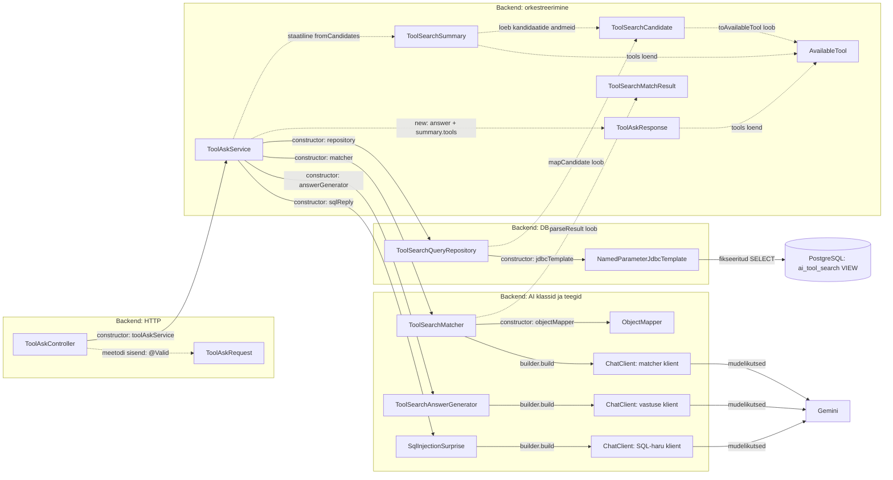
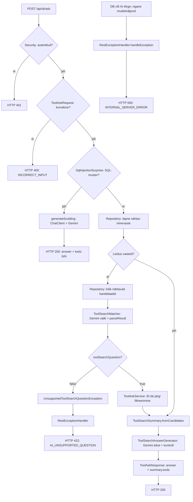

# AI otsingu swimlane ja klasside sõltuvused

**Koodi seis:** 12.10.2026.  
**Brauseris avatav skeem:** [ai-otsingu-swimlane.html](ai-otsingu-swimlane.html).  
**Põhjalik selgitus:** [ai-otsingumootori-selgitus.md](ai-otsingumootori-selgitus.md).

Skeemid kirjeldavad aktiivset `POST /api/ai/ask` päringu töötlemist `src/main` koodi järgi. Mermaid-plokid on muudetavad diagrammiallikad; HTML sisaldab ilma võrguühenduseta avatavaid SVG-skeeme.

## 1. Rajad ja noolte tähendus

| Rada | Klassid või komponent | Mida teeb? |
| --- | --- | --- |
| Brauser | `AiSearchView.vue`, axios | Küsimus, HTTP päring, lõppvastuse kontroll ja kuvamine. |
| Backend: API | `SecurityFilterChain`, `ToolAskController`, `ToolAskRequest` | Autentimine, sisendi kontroll, teenuse kutsumine ja JSON-vastus. |
| Backend: töövoo juht | `ToolAskService` | Harude ja kutsete järjekord, kandidaatide filtreerimine, kokkuvõtte ning vastuse loomine. |
| Backend: DB ligipääs | `ToolSearchQueryRepository`, `NamedParameterJdbcTemplate` | Fikseeritud SELECT-päringud, `mapCandidate()`. |
| PostgreSQL | `tool_rental.ai_tool_search` | Vaate read, nähtavus ja tänane saadavus. |
| Backend: AI teenused | `ToolSearchMatcher`, `ToolSearchAnswerGenerator`, `SqlInjectionSurprise`, `ChatClient`, `ObjectMapper` | Prompt'id, AI-kutsed ning mudeliväljundi töötlemine. |
| Väline mudeliteenus | Gemini | Valiku JSON või vastusetekst. |

Swimlane'i aeg kulgeb ülalt alla. Täisjoonega nool on meetodikutsung või päring; katkendjoon on tagastus. Nool võib läbida teiste osalejate vertikaalset rada: saaja on noole otsas olev osaleja.

Klasside sõltuvusskeemis tähendab konstruktorisõltuvus objekti välja, mis antakse klassi loomisel. Staatiline `ToolSearchSummary.fromCandidates(...)` kutse ja `new ToolAskResponse(...)` on eraldi väärtusobjektide kasutused.

## 2. Päringu töötluse swimlane

```mermaid
sequenceDiagram
    autonumber
    box Brauser
        participant F as AiSearchView.vue
    end
    box Backend: API
        participant C as SecurityFilterChain / ToolAskController
    end
    box Backend: töövoo juht
        participant S as ToolAskService
    end
    box Backend: DB ligipääs
        participant R as ToolSearchQueryRepository / JDBC
    end
    box PostgreSQL
        participant D as ai_tool_search VIEW
    end
    box Backend: AI teenused
        participant A as Matcher / AnswerGenerator / SqlInjectionSurprise
    end
    box Väline mudeliteenus
        participant G as Gemini
    end

    F->>C: POST /api/ai/ask, {question}
    Note over C: Security kontrollib kasutajat; @Valid kontrollib ToolAskRequest'i
    C->>S: ask(request.question())
    S->>A: SqlInjectionSurprise.isSqlInjectionAttempt(question)
    A-->>S: boolean

    alt SQL-mustri tabamus
        S->>A: SqlInjectionSurprise.generateScolding(question)
        A->>G: ChatClient: Linux-admini prompt + küsimus
        G-->>A: Keeldumistekst
        Note over A: Mittetühjus, trim(), sudo vorminduse puhastus
        A-->>S: String answer
        S-->>C: new ToolAskResponse(answer, List.of())
        C-->>F: HTTP 200, answer + tools: []
    else Tavapärane tööriistaotsing
        S->>R: findVisibleToolsByExactName(question.trim())
        R->>D: jdbcTemplate.query: nähtav + LOWER(:name)
        D-->>R: ResultSet read
        Note over R: mapCandidate() loob ToolSearchCandidate'id
        R-->>S: List of ToolSearchCandidate: matches

        opt Täpseid nimevasteid ei ole
            S->>R: findVisibleTools()
            R->>D: jdbcTemplate.query: kõik nähtavad, tool_id ASC
            D-->>R: ResultSet read
            R-->>S: List of ToolSearchCandidate: candidates
            S->>A: ToolSearchMatcher.match(question, candidates)
            Note over A: ObjectMapper.writeValueAsString(candidates)
            A->>G: ChatClient: valija prompt + küsimus + kandidaatide JSON
            G-->>A: JSON: toolSearchQuestion + toolIds
            Note over A: parseResult: kuju, candidate ID-d, kordused, kuni 20
            A-->>S: ToolSearchMatchResult
            break toolSearchQuestion = false
                S-->>C: UnsupportedToolSearchQuestionException
                Note over C: RestExceptionHandler teeb erandist ApiError'i
                C-->>F: HTTP 422, AI_UNSUPPORTED_QUESTION
            end
            S->>S: Filtreerib candidates kontrollitud ID-de järgi
        end

        Note over S: Edasine töövoog jätkub ainult teemakohase tulemuse korral
        S->>S: ToolSearchSummary.fromCandidates(question, matches)
        Note over S: tools ainult availableNow; arvud + ühine asukoht/kategooria
        S->>A: ToolSearchAnswerGenerator.generateAnswer(summary)
        A->>G: ChatClient: küsimus + arvud + ühised faktid
        Note over A,G: tools loendit sellele prompt'ile ei lisata
        G-->>A: String: vastusetekst
        Note over A: Mittetühjus, trim(), keelatud alguste kontroll
        A-->>S: String answer
        S-->>C: new ToolAskResponse(answer, summary.tools())
        C-->>F: HTTP 200, JSON: answer + tools
        Note over F: isValidToolSearchResponse(); tekst + /tools/:toolId lingid
    end
```

**Täpse nime otsetee:** kui esimene DB päring leiab nähtavaid vasteid, jäävad kõik `opt` ploki toimingud vahele. Kokkuvõtte loomine ja vastuseteksti AI-kutse tehakse ka selles harus.

**Tühi kandidaatide või sobivate ID-de loend:** teemakohane küsimus jätkab nullidega kokkuvõttesse. Teenus ei jäta AI valikut vahele pelgalt tühja kandidaatide loendi tõttu.

## 3. Teenuste ja klasside sõltuvused



### Konstruktorisõltuvuste täpsustus

| Klass | Konstruktori argumendid | Tulemus |
| --- | --- | --- |
| `ToolAskController` | `ToolAskService` | Lomboki `@RequiredArgsConstructor` kaudu väljas `toolAskService`. |
| `ToolAskService` | Repository, matcher, answerGenerator, sqlReply | Neli teenuse sõltuvust. |
| `ToolSearchQueryRepository` | `NamedParameterJdbcTemplate` | Väli `jdbcTemplate`. |
| `ToolSearchMatcher` | `ChatClient.Builder`, `ObjectMapper` | Builderist `build()`-iga klient; mapper väljas. |
| `ToolSearchAnswerGenerator` | `ChatClient.Builder` | Builderist oma `ChatClient`. |
| `SqlInjectionSurprise` | `ChatClient.Builder` | Builderist oma `ChatClient`. |

Kolme AI klassi `ChatClient` tähistab sama teegitüüpi, kuid iga klass kutsub konstruktoris `build()`-i. Diagramm ei eelda ühist `ChatClient` objekti.

`ToolSearchSummary` ja vastuse record'id on väärtusobjektid. Neid ei süstita `ToolAskService` konstruktorisse Springi teenustena.

## 4. Andmete teisendused piiridel

| Piir | Enne | Pärast | Vastutaja |
| --- | --- | --- | --- |
| HTTP sisend | JSON `{question}` | `ToolAskRequest` | Spring MVC ja valideerimine. |
| Controller → teenus | `ToolAskRequest` | `String question` | `ToolAskController`. |
| DB → repository | Vaate seitse SELECT-välja | `ToolSearchCandidate` | `mapCandidate()`. |
| Repository → valija | Kandidaatide Java loend | JSON string | `ObjectMapper` matcher'is. |
| Gemini → valija | Valiku JSON tekst | `ToolSearchMatchResult` | `parseResult()`. |
| Teenuse ID-filter | Kandidaadid + kontrollitud ID-d | Sobivate kandidaatide loend | `ToolAskService`. |
| Sobivad → kokkuvõte | `List<ToolSearchCandidate>` | `ToolSearchSummary` | `fromCandidates()`. |
| Kandidaat → avalik tööriist | Seitse välja | ID, nimi, kategooria, location | `toAvailableTool()`. |
| Kokkuvõte → AI tekst | Küsimus, arvud, ühine location/category | Lühike tekst | `ToolSearchAnswerGenerator` ja Gemini. |
| Teenus → HTTP | `ToolAskResponse(answer, tools)` | JSON | Spring MVC. |
| HTTP → UI | Vastuse JSON | Tekst ja tööriistalingid | `isValidToolSearchResponse()` ning Vue. |

### Tähtsad andmepiirid

- `is_visible` kasutatakse DB päringute filtrina; kandidaadi record ei sisalda seda välja.
- Valija saab nii saadavad kui ka praegu broneeritud nähtavad kandidaadid.
- Teenuse tulemuste järjekord tuleb DB kandidaatide järjekorrast.
- Kokkuvõtte arvud arvutatakse Java sobivate loendist; selles harus eraldi `COUNT(*)` ei tehta.
- Vastuse koostaja ei saa `tools` loendit.
- Lõppvastuses puuduvad eraldi `city`, `description`, `availableNow` ja arvude väljad.

## 5. Eriharud ja veakäsitlus



`SecurityFilterChain` käivitub enne controller'i tööd. `RestExceptionHandler` teisendab töötluses tekkinud erandeid; see ei ole `ToolAskService` constructor-väli.

422 harul ei käivitata vastuse koostajat. Tühja, kuid teemakohase tulemuse puhul vastuse koostaja käivitatakse. SQL-haru ei tee otsingu DB päringuid.

## 6. Millised klassid sellesse töövoogu ei kuulu?

`ToolSearchSqlGenerator`, `ToolSearchSqlValidator` ning repository `search()` ja `searchWithCounts()` on projektis olemas, kuid praegune `ToolAskService.ask()` neid ei kutsu.

IntelliJ `sessions` virtuaalne seirevaade ei anna otsingule kandidaatide andmeid. AI endpoint kasutab `ai_tool_search` vaadet.

`src/test` kood ei ole selle runtime-töövoo osaleja. Skeemid on koostatud rakenduse `src/main` failidest ja Vue otsinguvaatest.

## 7. Allikad

- [ToolAskController.java](../../backend/src/main/java/ee/toolrental/aimodule/ToolAskController.java)
- [ToolAskRequest.java](../../backend/src/main/java/ee/toolrental/aimodule/ToolAskRequest.java)
- [ToolAskService.java](../../backend/src/main/java/ee/toolrental/aimodule/ToolAskService.java)
- [ToolSearchQueryRepository.java](../../backend/src/main/java/ee/toolrental/aimodule/ToolSearchQueryRepository.java)
- [ToolSearchMatcher.java](../../backend/src/main/java/ee/toolrental/aimodule/ToolSearchMatcher.java)
- [ToolSearchMatchResult.java](../../backend/src/main/java/ee/toolrental/aimodule/ToolSearchMatchResult.java)
- [ToolSearchSummary.java](../../backend/src/main/java/ee/toolrental/aimodule/ToolSearchSummary.java)
- [ToolSearchAnswerGenerator.java](../../backend/src/main/java/ee/toolrental/aimodule/ToolSearchAnswerGenerator.java)
- [SqlInjectionSurprise.java](../../backend/src/main/java/ee/toolrental/aimodule/SqlInjectionSurprise.java)
- [ToolSearchCandidate.java](../../backend/src/main/java/ee/toolrental/aimodule/ToolSearchCandidate.java)
- [AvailableTool.java](../../backend/src/main/java/ee/toolrental/aimodule/AvailableTool.java)
- [ToolAskResponse.java](../../backend/src/main/java/ee/toolrental/aimodule/ToolAskResponse.java)
- [SecurityConfig.java](../../backend/src/main/java/ee/toolrental/infrastructure/security/SecurityConfig.java)
- [RestExceptionHandler.java](../../backend/src/main/java/ee/toolrental/infrastructure/RestExceptionHandler.java)
- [AiSearchView.vue](../../frontend/src/views/AiSearchView.vue)
- [2_create.sql](../database/2_create.sql)

Skeemid põhinevad koodilugemisel. Selle dokumenteerimise käigus rakenduse teste ei käivitatud.
