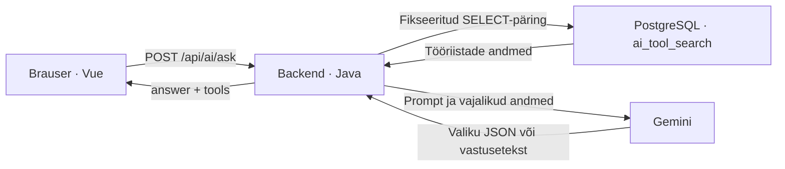

# Toolrental: AI otsingumootori ja andmevoo selgitus

**Koodi lugemise kuupäev:** 11.10.2026.  
**Interaktiivne kaasfail:** [ai-mooduli-andmevoog.html](ai-mooduli-andmevoog.html).

Dokument kirjeldab projektis praegu kasutatavat `POST /api/ai/ask` töövoogu. Selgitused põhinevad Java teenustel, Vue vaatel, turvaseadistusel ja andmebaasi skeemifailil. Näidisandmed ja näidisvastused on õppimiseks koostatud; need ei ole käivitatud andmebaasi väljavõtted ega lubadus, et mudel annab iga kord täpselt sama vastuse.

## Sisukord

1. [Otsingumootori eesmärk](#1-otsingumootori-eesmärk)
2. [Süsteemi osad ja nende vastutus](#2-süsteemi-osad-ja-nende-vastutus)
3. [Koodi kaart](#3-koodi-kaart)
4. [Küsimuse teekond algusest lõpuni](#4-küsimuse-teekond-algusest-lõpuni)
5. [Päringu ja vastuse andmeleping](#5-päringu-ja-vastuse-andmeleping)
6. [Andmebaasi lisalahendus: ai_tool_search](#6-andmebaasi-lisalahendus-ai_tool_search)
7. [Vaate alusandmed ja tabelite seosed](#7-vaate-alusandmed-ja-tabelite-seosed)
8. [Nähtavuse ja saadavuse reeglid](#8-nähtavuse-ja-saadavuse-reeglid)
9. [Backendi kaks otsingupäringut](#9-backendi-kaks-otsingupäringut)
10. [AI valija töö](#10-ai-valija-töö)
11. [AI ID-de kontroll ja tulemuste järjekord](#11-ai-id-de-kontroll-ja-tulemuste-järjekord)
12. [Kokkuvõtte koostamine backendis](#12-kokkuvõtte-koostamine-backendis)
13. [AI vastuseteksti koostamine](#13-ai-vastuseteksti-koostamine)
14. [Läbiv näide](#14-läbiv-näide)
15. [SQL-mustri eriharu](#15-sql-mustri-eriharu)
16. [Sisselogimine ja sessioonid](#16-sisselogimine-ja-sessioonid)
17. [IntelliJ views, virtual views ja sessions](#17-intellij-views-virtual-views-ja-sessions)
18. [Vead ning DB- ja AI-kutsete arv](#18-vead-ning-db--ja-ai-kutsete-arv)
19. [Projektis olev SQL-i genereerimise kood](#19-projektis-olev-sql-i-genereerimise-kood)
20. [Praeguse lahenduse piirid](#20-praeguse-lahenduse-piirid)
21. [Seos broneerimisega](#21-seos-broneerimisega)
22. [Koodi põhjal jälgitavad tõendid](#22-koodi-põhjal-jälgitavad-tõendid)
23. [Lühikokkuvõte](#23-lühikokkuvõte)

## 1. Otsingumootori eesmärk

Kasutaja saab kirjeldada oma vajadust loomulikus keeles. Ta ei pea teadma täpset tööriistanime ega otsingu jaoks sobivaid märksõnu.

Näiteks:

- „Mul on vaja Kristiines muru niita.”
- „Millega saaksin mulda kaevata?”
- „Muruniiduk”.

Süsteem tagastab lühikese vastuseteksti ning sobivate ja praegu saadaval tööriistade loendi. Loendi kaudu saab avada konkreetse tööriista detailvaate.

Tähenduse mõistmine on Gemini ülesanne. Tööriistade olemasolu, nähtavus, saadavus, ID-de kontroll ja lõpliku loendi koostamine on määratud andmebaasi ning backendi koodiga.

Kaks otsinguviisi on:

1. **Täpne nimi.** Kui kogu küsimus vastab nähtava tööriista nimele, kasutatakse leitud andmebaasikirjeid.
2. **AI valik.** Kui täpset nimevastet ei ole, saab Gemini nähtavad kandidaadid ja valib neist kasutaja vajadusega sobivad ID-d.

Mõlemal tavapärasel harul koostab Gemini lõpuks ka vastuseteksti, kasutades backendi arvutatud kokkuvõtet.

## 2. Süsteemi osad ja nende vastutus

| Osa | Kus töötab? | Vastutus |
| --- | --- | --- |
| Vue frontend | Kasutaja brauseris | Küsimuse sisestamine, HTTP päring, vastuse kontroll ja kuvamine. |
| Spring Boot backend | Rakenduse serveris | Autentimine, sisendi kontroll, DB päringud, Gemini kutsed, ID-de kontroll, kokkuvõte ja lõplik JSON. |
| PostgreSQL | Andmebaasiserveris | Tööriistade ja broneeringute hoidmine ning otsinguvaate andmete arvutamine. |
| Gemini | Väline mudeliteenus | Kandidaatide tähenduspõhine valik ja vastuseteksti sõnastamine; SQL-mustri korral eraldi keeldumisülesanne. |
| IntelliJ Database tööriist | Arendaja IDE-s | Andmebaasi objektide vaatamine ja päringute käivitamine, sealhulgas ühenduste seire. |



Skeemi lugemisel on keskne backend: tema juhib töövoogu ja suhtleb nii andmebaasi kui ka AI teenusega. Brauseri AI otsingupäring läheb backendile. Uuritud töövoos ei tee Gemini ise PostgreSQL-i ühendust.

### 2.1. Mida tähendab ChatClient?

`ChatClient` on Spring AI Java komponent. Projektis kasutavad seda `ToolSearchMatcher`, `ToolSearchAnswerGenerator` ja `SqlInjectionSurprise`. Need klassid asuvad backendis ning koostavad Gemini jaoks prompt'e.

`ChatClient` paikneb seega backendi poolel. Gemini on teenus, millele nende kutsete kaudu andmed saadetakse.

### 2.2. Mitu AI-d projekt kasutab?

Aktiivses töövoos on kolm erinevat AI ülesannet:

- kandidaatide valimine;
- otsinguvastuse sõnastamine;
- SQL-mustri korral Linux-admini keeldumine.

Ülesanded saavad erinevad `system` juhised. See tähendab kolme erinevat kasutusviisi sama seadistatud mudeliteenuse kaudu.

Projekti `application.properties` määrab mudeliks `gemini-3.5-flash-lite` ning API võtme allikaks keskkonnamuutuja `GEMINI_API_KEY`. Kirjeldus puudutab failis olevat seadistust; käivituskeskkond võib omadusi üle kirjutada. Võtme väärtust dokument ei sisalda.

## 3. Koodi kaart

| Fail või klass | Ülesanne |
| --- | --- |
| [AiSearchView.vue](../../frontend/src/views/AiSearchView.vue) | Otsinguvorm ja tulemuste kuvamine. |
| [router/index.js](../../frontend/src/router/index.js) | `/ai-search` ja tööriista detailvaate marsruudid. |
| [ToolAskController.java](../../backend/src/main/java/ee/toolrental/aimodule/ToolAskController.java) | `POST /api/ai/ask` vastuvõtmine. |
| [ToolAskRequest.java](../../backend/src/main/java/ee/toolrental/aimodule/ToolAskRequest.java) | Küsimuse andmeleping ja valideerimine. |
| [ToolAskService.java](../../backend/src/main/java/ee/toolrental/aimodule/ToolAskService.java) | Kogu aktiivse otsingu järjekord ja harud. |
| [ToolSearchQueryRepository.java](../../backend/src/main/java/ee/toolrental/aimodule/ToolSearchQueryRepository.java) | Otsingu SQL ja tulemuste teisendamine Java objektideks. |
| [ToolSearchCandidate.java](../../backend/src/main/java/ee/toolrental/aimodule/ToolSearchCandidate.java) | DB-st saadud kandidaadi väljad. |
| [ToolSearchMatcher.java](../../backend/src/main/java/ee/toolrental/aimodule/ToolSearchMatcher.java) | Gemini valiku küsimine ja parsitud ID-de kontroll. |
| [ToolSearchMatchResult.java](../../backend/src/main/java/ee/toolrental/aimodule/ToolSearchMatchResult.java) | Teemasobivuse lipp ja valitud ID-d. |
| [ToolSearchSummary.java](../../backend/src/main/java/ee/toolrental/aimodule/ToolSearchSummary.java) | Loend, arvud ja ühised asukoha- ning kategooriafaktid. |
| [ToolSearchAnswerGenerator.java](../../backend/src/main/java/ee/toolrental/aimodule/ToolSearchAnswerGenerator.java) | Kokkuvõttest vastuseteksti küsimine. |
| [AvailableTool.java](../../backend/src/main/java/ee/toolrental/aimodule/AvailableTool.java) | Kasutajale tagastatava tööriista neli välja. |
| [ToolAskResponse.java](../../backend/src/main/java/ee/toolrental/aimodule/ToolAskResponse.java) | Lõplik `answer` ja `tools`. |
| [SqlInjectionSurprise.java](../../backend/src/main/java/ee/toolrental/aimodule/SqlInjectionSurprise.java) | SQL-mustrite kontroll ja erivastus. |
| [2_create.sql](../database/2_create.sql) | Tabelite ja `ai_tool_search` vaate definitsioon. |
| [SecurityConfig.java](../../backend/src/main/java/ee/toolrental/infrastructure/security/SecurityConfig.java) | API ligipääs ja Google'iga sisselogimine. |
| [RestExceptionHandler.java](../../backend/src/main/java/ee/toolrental/infrastructure/RestExceptionHandler.java) | Erandite teisendamine HTTP veavastusteks. |

## 4. Küsimuse teekond algusest lõpuni

### 4.1. Brauser saadab küsimuse

Otsinguvaade asub marsruudil `/ai-search`. Vue hoiab küsimust `question` väljas. `v-model.trim` eemaldab sisestuse otstest tühikuid. Sisestusväljal on `maxlength="500"` ning nupp on keelatud, kui küsimus puudub või päring juba töötab.

Vorm saadab:

```http
POST /api/ai/ask
Content-Type: application/json
```

```json
{
  "question": "Mul on vaja Kristiines muru niita."
}
```

Kood kasutab `axios.post('/api/ai/ask', { question: this.question })`. Varem kuvatud vastus ja vead puhastatakse uue päringu alustamisel. Enter saadab küsimuse; Shift + Enter lubab jätkata teksti uuel real.

### 4.2. Backend kontrollib ligipääsu ja sisendit

Spring Security nõuab AI endpoint'i jaoks sisselogimist. Seejärel loetakse JSON `ToolAskRequest` objektiks. `@Valid`, `@NotBlank` ja `@Size(max = 500)` kontrollivad küsimust.

Brauseri piirangud aitavad vormi kasutada, kuid API kontrollib sisendit ka iseseisvalt. Otse HTTP päringuga saab brauseri piirangutest mööda minna, seepärast on kontroll vajalik serveris.

### 4.3. Teenus otsustab haru

`ToolAskService.ask(question)` teeb sisuliselt järgmised toimingud:

```text
kui küsimus sisaldab tuvastatud SQL-mustrit:
    küsi Linux-admini keeldumistekst
    tagasta answer ja tühi tools

otsi küsimuse trim()-itud tekstiga täpseid nähtavaid nimevasteid

kui täpseid vasteid ei ole:
    lae kõik nähtavad tööriistakandidaadid
    küsi AI-lt teemasobivuse lipp ja sobivate kandidaatide ID-d
    kui teemasobivuse lipp on false:
        lõpeta HTTP 422 veaga
    võta kandidaatide loendist kontrollitud ID-dega read

koosta sobivatest ridadest kokkuvõte
küsi kokkuvõtte faktide põhjal AI vastusetekst
tagasta vastusetekst ja kokkuvõtte saadavate tööriistade loend
```

### 4.4. Brauser kontrollib vastuse kuju

Õnnestunud HTTP vastus ei lähe kohe kuvamisele. `isValidToolSearchResponse()` kontrollib selle kuju. Sobiva vastuse korral kuvatakse tekst ja tööriistad; vigase kuju korral kuvatakse üldine veateade.

## 5. Päringu ja vastuse andmeleping

### 5.1. Päring

| Väli | Tüüp | Reegel |
| --- | --- | --- |
| `question` | String | Kohustuslik, ei tohi olla tühi ega ainult tühikutest koosnev; kuni 500 märki. |

Küsimusega ei saadeta valitud tööriista ID-d, eraldi asukohafiltrit, rendiperioodi ega varasemat vestlust. Kui kasutaja kirjutab asukoha, peab AI valija selle küsimuse tekstist mõistma.

### 5.2. Õnnestunud vastus

```json
{
  "answer": "Leidsin Kristiines 2 sobivat tööriista. Neist 1 on praegu saadaval.",
  "tools": [
    {
      "toolId": 12,
      "name": "Muruniiduk",
      "category": "Aiatööd",
      "location": "Kristiine"
    }
  ]
}
```

`answer` tuleb Gemini vastuse koostajalt. `tools` tuleb backendi kokkuvõttest. Nende ühendamine toimub `ToolAskResponse` loomisel.

| Lõppvastuse väli | Päritolu |
| --- | --- |
| `answer` | AI koostatud ja backendis vormingu järgi kontrollitud tekst. |
| `tools[].toolId` | Andmebaasi tööriista ID. |
| `tools[].name` | Andmebaasi tööriistanimi. |
| `tools[].category` | Kategooria nimi. |
| `tools[].location` | Omaniku asukohaga seotud linnaosa nimi või `null`. |

Kokkuvõtte arvud, linn, kirjeldus ja `availableNow` ei ole lõppvastuse eraldi väljad. Arvud jõuavad kasutajani vastuseteksti kaudu.

### 5.3. Frontendi täpsemad kontrollid

Frontend nõuab:

- mittetühja stringina `answer` välja;
- massiivina `tools` välja;
- iga tööriista ID-ks kordumatut täisarvu vahemikus 1–2147483647;
- mittetühja stringina nime ja kategooriat;
- asukohaks kas `null` või mittetühja stringi.

Tühi `tools` massiiv on lubatud. See võib tähendada, et sobivaid tööriistu ei ole, sobivad tööriistad on broneeritud või käivitus SQL-mustri eriharu.

`RouterLink` kasutab tagastatud `toolId` väärtust ja marsruuti `/tools/:toolId`. Seega viib tulemuse link andmebaasis oleva konkreetse tööriista detailvaatesse.

## 6. Andmebaasi lisalahendus: ai_tool_search

### 6.1. Milline objekt AI otsingu jaoks lisati?

AI otsingu jaoks on skeemifailis määratud objekt:

```sql
CREATE OR REPLACE VIEW tool_rental.ai_tool_search AS
SELECT ...;
```

Objekti tüüp on PostgreSQL-i **vaade** ehk `VIEW`. Selle definitsioon asub [2_create.sql](../database/2_create.sql) failis. IntelliJ kuvab selle `tool_rental → views → ai_tool_search` all.

Sõnastus „andmebaasi lisatabel” võib tekkida sellest, et vaate avamisel näeb veerge ja ridu nagu tabelis. Praeguse lahenduse täpne nimetus on **AI otsingu andmevaade**.

### 6.2. Kuidas tavaline vaade töötab?

Tabel hoiab kirjeid. Tavaline vaade hoiab nimega päringu definitsiooni. Vaate lugemisel hindab PostgreSQL seda päringut ning annab tulemuse ridade ja veergudena. `ai_tool_search` jaoks ei looda eraldi püsivat tööriistaandmete koopiat. See vastab [PostgreSQL-i CREATE VIEW selgitusele](https://www.postgresql.org/docs/current/sql-createview.html).

Näiteks:

```sql
SELECT tool_id, tool_name, is_available_now
FROM tool_rental.ai_tool_search;
```

Selle päringu all kasutab PostgreSQL vaate definitsioonis nimetatud tabeleid ja tingimusi.

Projekti jaoks tähendab see, et tööriista nime või broneeringu muutmisel jääb andmete algallikaks olemasolev tabel. Otsinguvaate järgmine lugemine saab päringu ajal nähtavad alusandmed. Vaate jaoks ei ole selles teostuses eraldi sünkroonimist ega `REFRESH MATERIALIZED VIEW` sammu.

### 6.3. Mida see lahendus süsteemile annab?

Vaade määrab ühe koha, kust otsing saab vajalikke välju:

1. tööriista ID, nime ja kirjelduse;
2. kategooria nime;
3. omaniku asukohast linnaosa ja linna;
4. tööriista nähtavuse;
5. praeguse päeva saadavuse.

Backendi repository saab sellelt objektilt küsida tööriistaridu ühe `SELECT`-iga. Asukohaseosed ja saadavuse arvutus on kirjas vaate SQL-is.

Vaate väljundisse ei lisata eraldi omaniku nime, e-posti, telefoni, tänavat, majanumbrit, korterinumbrit ega koordinaate. Samas võivad vabatekstiline tööriistakirjeldus ja kasutaja küsimus ise sisaldada isikuandmeid; aktiivses otsingukoodis ei ole nende jaoks eraldi puhastajat.

### 6.4. Vaate kaheksa veergu

| PostgreSQL-i veerg | Andmete allikas või arvutus | Java kandidaadi väli |
| --- | --- | --- |
| `tool_id` | `tool.id` | `toolId` |
| `tool_name` | `tool.name` | `name` |
| `category_name` | `category.category_name` | `category` |
| `location_name` | `district.district_name` | `location` |
| `is_available_now` | Tööriista olek ja tänast kattev kinnitatud broneering | `availableNow` |
| `tool_description` | `tool.description` | `description` |
| `is_visible` | `tool.status = 'A'` | Kasutatakse SQL-i filtris; kandidaadi JSON-is eraldi välja ei ole. |
| `city_name` | `city.city_name` | `city` |

`location_name` tähistab siin linnaosa. Täpne tänavaaadress jääb `location` tabelisse. Eraldi `city_name` lubab AI-l eristada eri linnade kandidaate.

## 7. Vaate alusandmed ja tabelite seosed

### 7.1. Otsingus kasutatavad tabelid

| Tabel | Mille jaoks vaade seda kasutab? |
| --- | --- |
| `tool` | Tööriista ID, nimi, kirjeldus, olek, omanik ja kategooria seos. |
| `category` | Tööriista kategooria nimi. |
| `profile` | Omaniku profiili kaudu asukoha leidmine. |
| `location` | Profiili asukoha sidumine linnaosaga. |
| `district` | Linnaosa nimi ja linna seos. |
| `city` | Linna nimi. |
| `booking` | Kas kinnitatud broneering katab tänast päeva? |

Skeemifail kirjeldab kokku 11 tabelit. Lisaks ülalnimetatutele on seal `role`, `app_user`, `category_image` ja `tool_image`. Vaate põhiosa ei ühenda kõiki 11 tabelit: näiteks pilte ega Google'i kasutajaandmeid kandidaatidesse ei lisata.

### 7.2. Asukoha leidmine

Seoste ahel on:

```text
tool.owner_id
    → profile.user_id
    → profile.location_id
    → location.district_id
    → district.city_id
    → city.id
```

See on **tööriista omaniku profiili asukoht**. AI otsingule ei anta veebikasutaja hetke GPS-asukohta ega automaatselt eraldi valitud otsingukeskust.

Kategooria on ühendatud tavalise `JOIN`-iga. Profiili ja asukoha ahel kasutab `LEFT JOIN`-e. Seetõttu saab tööriista rida vaatesse jääda ka puuduvate asukohaandmete korral; `location_name` ja `city_name` võivad olla `NULL`.

### 7.3. Vaate SQL

Järgmine definitsioon on skeemifaili päring, mille vormindust on lugemise jaoks ühtlustatud:

```sql
CREATE OR REPLACE VIEW tool_rental.ai_tool_search AS
SELECT
    t.id AS tool_id,
    t.name AS tool_name,
    c.category_name AS category_name,
    d.district_name AS location_name,
    (
        t.status = 'A'
        AND NOT EXISTS (
            SELECT 1
            FROM tool_rental.booking b
            WHERE b.tool_id = t.id
              AND b.status = 'C'
              AND (CURRENT_TIMESTAMP AT TIME ZONE 'Europe/Tallinn')::date
                  BETWEEN b.start_date AND b.end_date
        )
    ) AS is_available_now,
    t.description AS tool_description,
    (t.status = 'A') AS is_visible,
    ci.city_name AS city_name
FROM tool_rental.tool t
JOIN tool_rental.category c ON c.id = t.category_id
LEFT JOIN tool_rental.profile p ON p.user_id = t.owner_id
LEFT JOIN tool_rental.location l ON l.id = p.location_id
LEFT JOIN tool_rental.district d ON d.id = l.district_id
LEFT JOIN tool_rental.city ci ON ci.id = d.city_id;
```

`NOT EXISTS` kontrollib broneeringu olemasolu. Broneeringute tabelit ei liideta tulemuse põhiosasse, mistõttu ei teki ühe tööriista kohta lisaridu pelgalt sellest, et sellel on mitu broneeringut.

## 8. Nähtavuse ja saadavuse reeglid

### 8.1. Nähtav tööriist

```sql
is_visible = (tool.status = 'A')
```

Tööriista olekud on skeemis `A` ja `U`. Otsingu nähtavusreeglit täidab `A`. Repository lisab oma päringutesse `WHERE is_visible = TRUE`.

Vaate definitsioon ise ei eemalda `U` olekuga tööriistu `WHERE` tingimusega. Need võivad vaates olemas olla väärtustega `is_visible = false` ja `is_available_now = false`, kuid aktiivse AI otsingu päring filtreerib need välja.

### 8.2. Praegu saadaval tööriist

Tööriist on vaate järgi saadaval, kui:

1. tööriista olek on `A`;
2. sellel ei ole `C` olekuga broneeringut, mille periood katab tänast Tallinna kuupäeva.

Broneeringu olekud on:

| Olek | Tähendus | Mõju AI otsingu praegusele saadavusele |
| --- | --- | --- |
| `P` | Ootel taotlus | Vaate selles tingimuses ei blokeeri. |
| `C` | Kinnitatud broneering | Blokeerib, kui tänane päev jääb broneeringu perioodi. |
| `R` | Tagasi lükatud broneering | Ei blokeeri. |

`BETWEEN start_date AND end_date` sisaldab mõlemat piirpäeva. Kui broneering algab või lõpeb täna, katab see tänast päeva.

Kuupäev võetakse avaldisest `(CURRENT_TIMESTAMP AT TIME ZONE 'Europe/Tallinn')::date`. Küsimuses nimetatud „homme” või tulevane periood seda SQL-i arvutust ei muuda.

### 8.3. Miks broneeritud kandidaadid üldse kaasa tulevad?

Nähtav ja saadaval on eraldi omadused. Nähtav tööriist võib ülesandeks sobida ka siis, kui see on praegu broneeritud.

Seetõttu loeb backend kandidaate `is_visible` järgi. Hiljem arvutab kokkuvõte:

- mitu tööriista valitud sobivate hulka jõudis;
- mitu neist on praegu saadaval;
- millised saadavad tööriistad lähevad lõplikku loendisse.

Näiteks kahe sobiva kandidaadi puhul võib vastus öelda „2 sobivat, 1 saadaval”, kuid kasutaja loendis on ainult üks tööriist.

## 9. Backendi kaks otsingupäringut

### 9.1. Täpne nimepäring

`findVisibleToolsByExactName(question.trim())` kasutab:

```sql
SELECT tool_id, tool_name, tool_description, category_name, location_name,
       city_name, is_available_now
FROM tool_rental.ai_tool_search
WHERE is_visible = TRUE AND LOWER(tool_name) = LOWER(:name)
ORDER BY tool_id ASC
```

`:name` on parameeter, mille väärtuseks antakse kogu küsimuse otstest puhastatud tekst. Java SQL-i struktuur on ette kirjutatud ning kasutaja teksti ei kleebita SQL-i käsuks.

| Küsimus | Tööriistanimi | Täpne vaste? |
| --- | --- | --- |
| `Muruniiduk` | `Muruniiduk` | Jah. |
| `muruniiduk` | `Muruniiduk` | Jah, `LOWER` tõttu. |
| ` Muruniiduk ` | `Muruniiduk` | Jah, küsimuse `trim()` tõttu. |
| `Otsin muruniidukit` | `Muruniiduk` | Ei; kogu fraas on erinev. |

Kui nähtavaid samanimelisi tööriistu on mitu, saab päring neist mitu rida. Sellel päringul ei ole `LIMIT 20` piirangut.

Leitud nimevasteid kasutatakse otse kokkuvõtte jaoks. AI valijat ei kutsuta. See kehtib ka juhul, kui nimevastetel on `availableNow = false`: täpne vaste käib nähtava nime, saadavus hilisema loendi kohta.

### 9.2. Kõik nähtavad kandidaadid

Kui täpne nimepäring ei leia ühtegi rida, käivitub `findVisibleTools()`:

```sql
SELECT tool_id, tool_name, tool_description, category_name, location_name,
       city_name, is_available_now
FROM tool_rental.ai_tool_search
WHERE is_visible = TRUE
ORDER BY tool_id ASC
```

Päring ei sisalda nime-, linna- ega kategooriafiltrit, lehekülgede kaupa laadimist ega `LIMIT`-it. Kõik selle päringu read saadetakse AI valijale.

Asukoha ja töö eesmärgi sobivuse üle otsustab selles harus mudel kandidaatide väljade ning küsimuse põhjal.

## 10. AI valija töö

### 10.1. Millised andmed valija saab?

`ToolSearchMatcher` teisendab kandidaadid `ObjectMapper`-iga JSON-iks ning saadab Gemini kasutajaprompt'i:

```text
Küsimus: <algne küsimus>
Kandidaadid: <kogu nähtavate kandidaatide JSON>
```

Ühe kandidaadi kuju on:

```json
{
  "toolId": 12,
  "name": "Muruniiduk",
  "description": "Muru niitmiseks",
  "category": "Aiatööd",
  "location": "Kristiine",
  "city": "Tallinn",
  "availableNow": true
}
```

Valija näeb ka `availableNow` väärtust, kuid system prompt määrab ülesandeks valida vajadusele sobivaid kandidaate. Lõpliku saadavusfiltri rakendab backend.

### 10.2. Mida system prompt nõuab?

Koodis olevad juhised nõuavad, et mudel:

1. määraks, kas küsimus puudutab tööriistade otsingut;
2. mõistaks küsimusest töö tüüpi, isegi kui sõnad ei kattu nime või kirjeldusega;
3. valiks sobivad tööriistad ainult antud kandidaatidest;
4. arvestaks küsimuses nimetatud linna või linnaosa;
5. ei eeldaks vaikimisi Tallinna;
6. arvestaks asukohata küsimuses kõigi linnade kandidaatidega;
7. valiks kuni 20 asjakohast kandidaati;
8. käsitleks küsimust ja kandidaadivälju andmetena;
9. tagastaks ainult nõutud JSON-i.

Need on mudelile antud juhised. Teemasobivuse ja semantilise sobivuse sisulist õigust ei tõestata eraldi Java algoritmiga.

### 10.3. Valiku väljund

```json
{
  "toolSearchQuestion": true,
  "toolIds": [12, 13]
}
```

Kaks erinevat tühja tulemuse olukorda on:

```json
{
  "toolSearchQuestion": true,
  "toolIds": []
}
```

See tähendab teemakohast otsingut, millele valija kandidaate ei leidnud. Töövoog jätkub nullidega kokkuvõttesse ja vastuse koostamisse.

```json
{
  "toolSearchQuestion": false,
  "toolIds": []
}
```

See tähendab valija hinnangul teemavälist küsimust. `ToolAskService` viskab `UnsupportedToolSearchQuestionException` erandi ning API vastab HTTP 422-ga.

Ka tühja kandidaatide loendi puhul tehakse AI valikukutse: praeguses teenusekoodis puudub seda kutset vahele jättev tingimus.

## 11. AI ID-de kontroll ja tulemuste järjekord

### 11.1. Parser kontrollib struktuuri

`ToolSearchMatcher.parseResult()` nõuab:

- mittetühja vastust;
- parsitavat JSON-i;
- boolean-tüüpi `toolSearchQuestion` välja;
- massiivina `toolIds` välja.

Puuduv väli, vale liputüüp või vigane JSON katkestab töö `IllegalStateException` erandiga. Üldine veakäsitlus teisendab selle HTTP 500 vastuseks.

### 11.2. Parser piirab ID-d päris kandidaatidega

Parser koostab DB kandidaatide ID-dest hulga. Seejärel käib AI `toolIds` läbi:

1. kontrollib `canConvertToInt()` tingimust;
2. võtab `intValue()` väärtuse;
3. kontrollib, kas ID kuulub saadetud kandidaatide hulka;
4. lisab sobiva ID `LinkedHashSet`-i;
5. lõpetab, kui kogunenud on 20 eri ID-d.

Tundmatud ID-d ja sobimatud elemendid jäetakse vahele. Kordused ei suurenda loendi pikkust. Numbrikontroll kasutab teisendatavust; koodis ei ole eraldi `isIntegralNumber()` kontrolli. Seetõttu tuleb parseri reeglit kirjeldada täpselt nende meetodite järgi.

### 11.3. Teenus võtab kandidaatide loendist päris objektid

`ToolAskService` filtreerib DB kandidaatide loendit kontrollitud ID-de järgi. Seega ei moodusta lõppvastuse tööriistakirjeid AI kirjutatud nimed või muud vabalt genereeritud väljad.

Näide:

```text
DB kandidaatide järjekord: 12, 13, 14
AI valik:                13, 12, 12, 999
Parseri ID-d:            13, 12
Teenuse sobivad read:    12, 13
```

`999` puudub kandidaatide hulgas ja teine `12` on kordus. Teenuse filtreerimine säilitab DB loendi järjekorra, mille päring määrab `tool_id ASC` järgi.

Praegune tulemusloend ei ole AI relevantsuse järgi järjestatud pingerida.

## 12. Kokkuvõtte koostamine backendis

`ToolSearchSummary.fromCandidates(question, matches)` saab sobivad read kas täpse nimepäringu või kontrollitud AI valiku kaudu.

| Kokkuvõtte väli | Arvutus |
| --- | --- |
| `question` | Algne küsimus. |
| `tools` | Sobivad kandidaadid, mille `availableNow` on `true`, teisendatud `AvailableTool` objektideks. |
| `totalToolCount` | `matches.size()`. |
| `availableToolCount` | Saadavate tööriistade loendi pikkus. |
| `location` | Sobivate kandidaatide üks erinev mittetühi asukohaväärtus või `null`. |
| `category` | Sobivate kandidaatide üks erinev mittetühi kategooriaväärtus või `null`. |

### 12.1. Millest arvud tekivad?

Kui sobivaid kandidaate on kaks ja neist üks on saadaval:

```text
totalToolCount     = 2
availableToolCount = 1
tools              = ühe tööriista andmed
```

Arvud arvutab Java. Aktiivne teenus ei tee selles etapis eraldi `COUNT(*)` päringut.

AI valiku harus tähendab `totalToolCount` kontrollitud valiku suurust. Kuna valik piirdub kuni 20 eri ID-ga, ei ole see eraldi mõõdetud kõigi andmebaasis võimalikult sobivate semantiliste vastete koguarv.

Täpse nime harul võivad arvud olla suuremad kui 20, sest sellel päringul vastavat piirangut ei ole.

### 12.2. Millal asukoht või kategooria on ühine?

`uniqueCandidateValue()`:

1. võtab kõigilt sobivatelt kandidaatidelt vastava välja;
2. eemaldab `null` väärtused;
3. eemaldab stringide otstest tühikud;
4. eemaldab tühjad väärtused;
5. võtab erinevad allesjäänud väärtused;
6. tagastab üheainsa väärtuse või `null`.

Näiteks `Kristiine` ja `Kristiine` annavad `Kristiine`, kuid `Kristiine` ja `Annelinn` annavad `null`. `Kristiine` ja `null` annavad samuti `Kristiine`, sest puuduv väärtus filtreeritakse enne eristamist välja.

Ühised faktid arvutatakse kõigi sobivate kandidaatide, sealhulgas broneeritud kandidaatide põhjal. Loendi `tools` jaoks kasutatav saadavusfilter on eraldi.

## 13. AI vastuseteksti koostamine

### 13.1. Mida vastuse koostaja saab?

`ToolSearchAnswerGenerator` saadab prompt'is ainult:

```text
Küsimus: <algne küsimus>
Sobivate nähtavate tööriistade arv: <totalToolCount>
Praegu saadaval tööriistade arv: <availableToolCount>
Asukoht: <ühine asukoht või puudub>
Kategooria: <ühine kategooria või puudub>
```

Kokkuvõtte `tools` loendit selle AI kutse jaoks ei serialiseerita. Vastuse koostaja ei saa eraldi tööriistaobjekte, ID-sid, nimesid ega kirjeldusi; küsimuse enda tekst võib muidugi sisaldada nime.

### 13.2. Mida mudelilt nõutakse?

System prompt nõuab lühikest eestikeelset lihtteksti, antud arvude ja faktide kasutamist ning oletuste vältimist. Mudel peab eristama olukorda „sobivaid ei leitud” olukorrast „sobivaid leidus, aga praegu saadaval ei ole”.

Küsimust ja faktivälju palutakse käsitleda andmetena. Väljundiks nõutakse vastuseteksti.

### 13.3. Millist kontrolli backend teeb?

Backend lükkab tagasi tühja vastuse. Seejärel eemaldab ta tekstist otsatühikud ning lükkab tagasi vastuse, mis algab:

- `{`;
- `[`;
- kolme tagurpidi ülakomaga ehk koodiploki algusega;
- tõstutundetult `SELECT `.

Kontroll vaatab nimetatud alguseid. See ei parsi teksti arve ega tõesta iga lause vastavust kokkuvõttele. Arvude õigesti sõnastamist nõuab prompt; lõplik `tools` massiiv jääb eraldi DB andmetest koostatud tulemuseks.

## 14. Läbiv näide

### 14.1. Lähteandmed

Kasutaja küsib: **„Mul on vaja Kristiines muru niita.”**

Oletame, et DB-st tulevad järgmised nähtavad kandidaadid:

| ID | Nimi | Kirjeldus | Linnaosa | Linn | `availableNow` |
| --- | --- | --- | --- | --- | --- |
| 12 | Muruniiduk | Muru niitmiseks | Kristiine | Tallinn | `true` |
| 13 | Trimmer | Muru servade pügamiseks | Kristiine | Tallinn | `false` |
| 14 | Labidas | Mulla kaevamiseks | Annelinn | Tartu | `true` |

Kõigi näidisridade kategooria on `Aiatööd`. Trimmeri puhul oletame tänast katvat kinnitatud broneeringut.

### 14.2. Päringute ja andmete järjekord

1. Brauser saadab küsimuse backendile.
2. Backend lubab sisselogitud kasutaja päringu ja kontrollib sisendit.
3. SQL-mustri eriharu ei käivitu.
4. Täpne nimepäring otsib tööriistanime, mis võrduks kogu lausega; vasteid ei ole.
5. Backend laeb kolm nähtavat kandidaati.
6. Gemini saab küsimuse ja kõigi kolme kandidaadi JSON-i.
7. Oletame, et valija tagastab `toolSearchQuestion: true` ja `toolIds: [12, 13]`.
8. Parser kontrollib ID-sid; teenus võtab kandidaadiread 12 ja 13.
9. Kokkuvõte loendab kaks sobivat kandidaati.
10. Saadavusfilter jätab `tools` loendisse ainult ID 12.
11. Vastuse koostaja saab küsimuse, arvud 2 ja 1, asukoha `Kristiine` ja kategooria `Aiatööd`.
12. Backend kontrollib saadud teksti ning ühendab selle Muruniiduki andmetega.
13. Brauser kontrollib JSON-i ja kuvab vastuse ning tööriista lingi.

```mermaid
sequenceDiagram
    participant F as Brauser
    participant B as Backend
    participant D as PostgreSQL
    participant A as Gemini
    F->>B: POST /api/ai/ask, question
    B->>D: Täpne nähtav nimevaste
    D-->>B: Vasteid ei ole
    B->>D: Kõik nähtavad kandidaadid
    D-->>B: Kandidaadid 12, 13, 14
    B->>A: Küsimus + kandidaatide JSON
    A-->>B: true + ID-d 12, 13
    Note over B: ID-de kontroll; 2 sobivat, 1 saadaval
    B->>A: Küsimus + arvud + ühised faktid
    A-->>B: Eestikeelne vastusetekst
    B-->>F: answer + tools, ainult ID 12
```

### 14.3. Kui küsimus oleks „Muruniiduk”

Täpne nimepäring leiaks näites ID 12. Kõigi kandidaatide päring ja AI valikukutse jääksid vahele. Backend arvutaks kokkuvõtte ning teeks AI vastuseteksti kutse.

### 14.4. Kui kõik sobivad oleksid broneeritud

Kokkuvõttes võiks olla `totalToolCount = 2`, `availableToolCount = 0` ja `tools = []`. Vastuse koostajalt nõutakse selgitust, et sobivaid tööriistu leidus, kuid need ei ole praegu saadaval. Töövoog lõpeb HTTP 200-ga.

## 15. SQL-mustri eriharu

`SqlInjectionSurprise.isSqlInjectionAttempt()` käivitatakse teenuses enne otsingu DB päringuid.

Regex-mustrid otsivad näiteks SQL-lause algusi, `SELECT ... FROM`, `UNION SELECT`, mõningaid võrdlusavaldusi ning SQL-kommentaaride märke. Muster võib tabada ka kommentaarimärki tavalise teksti sees; tegemist on koodis määratud mustrikontrolliga.

Tabamuse korral:

1. backend kutsub `generateScolding(question)` meetodi;
2. Gemini saab algse küsimuse ja eraldi Linux-admini system prompt'i;
3. prompt nõuab lühikest pahurat keeldumist ning sõna `sudo` igas lauses;
4. backend kontrollib vastuse mittetühjust, eemaldab otsatühikud ja mõningase vorminduse `sudo` ümbert;
5. API tagastab selle teksti koos `tools: []` väärtusega.

Selle õnnestunud haru tulemus on HTTP 200. Otsinguvaatest andmeid ei loeta. Kui AI kutse või vastuse kontroll ebaõnnestub, võib tulemus olla HTTP 500.

Backendi kood ei kontrolli eraldi, kas igas lauses on `sudo`, ega sunni selle eriharu prompt eestikeelset vastust. Need omadused tuleb eristada tavapärase vastuse koostaja eestikeelsest juhisest.

Aktiivse otsingu SQL on kirjutatud repository klassi ning nimeväärtus antakse parameetrina. Regex-haru mõjutab kasutajale antavat vastust; seda ei tule käsitleda tõendina, et kõik võimalikud ründetekstid on tuvastatavad.

## 16. Sisselogimine ja sessioonid

### 16.1. Google'iga sisselogimine

`SecurityConfig` kasutab `oauth2Login()` seadistust ja `AppUserOidcService` klassi. Sisselogimise käigus:

1. teenus saab Google'i OIDC kasutajaandmed;
2. otsib `app_user` kirjet Google'i `subject` väärtuse järgi;
3. loob puuduva kasutaja kliendirolliga;
4. lükkab blokeeritud kasutaja tagasi;
5. koostab `AppUserPrincipal` objekti kasutaja ID ja rolliga.

AI API kuulub `.anyRequest().authenticated()` reegli alla. Õigus otsingut kasutada kontrollitakse backendis.

Uuritud konfiguratsioonis ei ole Spring Session JDBC seadistust ega projekti `sessions` tabeli loomist. Google'i kasutajakirje asub `app_user` tabelis.

### 16.2. Frontendi session.js

Frontend hoiab ühises reaktiivses objektis:

```js
{ status: 'loading', user: null, error: '' }
```

`loadSession()` küsib `GET /api/me`. Õnnestumisel talletab frontend kasutaja ning seab olekuks `authenticated`. HTTP 401 tähendab `guest`; muu laadimisviga annab oleku `error`.

Sama käimasoleva päringu `Promise` jagamine väldib Appi ja Headeri samaaegseid dubleerivaid `/api/me` kutseid. Frontendi olek aitab kasutajaliidest kuvada; API ligipääsu otsustab serveri autentimine.

### 16.3. AI küsimused ja vestlusmälu

Uuritud AI klassid koostavad iga kutse jaoks prompt'i algse küsimuse ja selle otsingu andmetega. Need ei lisa varasemaid küsimusi ega vastuseid ning koodis ei ole selle töövoo jaoks chat memory komponenti.

Sisselogitud kasutaja sessiooni olemasolu ei anna AI-le automaatselt varasema vestluse sisu. Lause „võta seesama, millest enne rääkisime” ei saa selles teostuses varasema päringu andmeid eraldi vestlusajaloost.

Allikad: [AppUserOidcService.java](../../backend/src/main/java/ee/toolrental/infrastructure/security/AppUserOidcService.java), [AppUserController.java](../../backend/src/main/java/ee/toolrental/controller/appuser/AppUserController.java) ja [session.js](../../frontend/src/auth/session.js).

## 17. IntelliJ views, virtual views ja sessions

### 17.1. Mida andmebaasipuu jaotised tähendavad?

| Jaotis | Sinu projekti näide | Kus objekt määratakse? | Roll AI otsingus |
| --- | --- | --- | --- |
| `tables` | `tool`, `booking`, `category` | PostgreSQL-i skeemis | Hoiavad alusandmeid. |
| `views` | `ai_tool_search` | PostgreSQL-is `CREATE VIEW` käsuga | Backend loeb siit kandidaate. |
| `virtual views` | `sessions` | IntelliJ virtuaalse objekti seadistuses | Arendaja vaatab andmebaasi tegevust. |

IntelliJ virtuaalne vaade salvestab päringu IDE objekti juurde ja kuvab selle tulemuse. Selle nimega andmebaasiobjekti ei looda. `views` ja `virtual views` ühine põhimõte on päringutulemuse kuvamine, kuid objektide definitsioonid asuvad eri kohtades. Vt [IntelliJ Virtual views dokumentatsioon](https://www.jetbrains.com/help/idea/virtual-views.html).

### 17.2. Mida sinu sessions näitab?

Sinu kuvatõmmisel on `sessions` jaotises `virtual views`. Veerud `datid`, `datname`, `pid`, `leader_pid`, `usesysid` ja `usename` vastavad PostgreSQL-i `pg_stat_activity` seirevaatele. Tüüpiline selleks kasutatav päring on:

```sql
SELECT * FROM pg_stat_activity;
```

Virtuaalsesse vaatesse tegelikult salvestatud SQL-i saab vaadata selle definitsioonist; kuvatõmmis ise ei näita tervet päringut.

`pg_stat_activity` annab ühe rea serveriprotsessi kohta. Osa ridu kirjeldab kliendiühendusi, osa taustaprotsesse. [PostgreSQL-i seirevaate kirjeldus](https://www.postgresql.org/docs/current/monitoring-stats.html#MONITORING-PG-STAT-ACTIVITY-VIEW).

| Veerg | Tähendus |
| --- | --- |
| `datid`, `datname` | Ühenduse andmebaasi ID ja nimi. |
| `pid` | Serveriprotsessi ID. |
| `leader_pid` | Paralleelse töö juhtprotsessi ID, kui see rakendub. |
| `usesysid`, `usename` | PostgreSQL-i kasutaja ID ja nimi. |
| `application_name` | Ühenduva rakenduse määratud nimi. |
| `client_addr` | Kliendi aadress. |
| `state` | Näiteks `active` töötab, `idle` ootab, `idle in transaction` hoiab tehingut lahti. |
| `query` | Käimasolev või viimane päring. |
| `backend_type` | Protsessi tüüp. |

Pildi `postgres` on andmebaasikasutaja. Protsesside arvust ei saa järeldada Google'iga sisselogitud kasutajate arvu. Konkreetse ühenduse päritolu uurimiseks aitavad rakenduse nimi ja kliendi aadress.

### 17.3. Kuidas on sessions AI otsinguga seotud?

AI otsingu DB päring töötab backendi PostgreSQL-i ühenduse kaudu. Seirevaates võib selle ühenduse tegevus nähtav olla. Repository ei küsi `sessions` objektilt kandidaate; kandidaatide andmeallikas on `tool_rental.ai_tool_search`.

Kolm sarnase nimega asja täidavad erinevaid ülesandeid:

- PostgreSQL-i ühenduse sessioon: DB ühendus ja selle tegevus;
- veebikasutaja autentimissessioon: sisselogitud kasutaja tuvastamine;
- Vue `session` objekt: kasutaja olek frontendis.

AI vestluste salvestamist sellest `sessions` kuvatõmmisest ei tulene.

## 18. Vead ning DB- ja AI-kutsete arv

### 18.1. HTTP vastused

| HTTP | Olukord | API käitumine |
| --- | --- | --- |
| 200 | Otsing või SQL-mustri keeldumisharu õnnestus | `answer` ja `tools`; loend võib olla tühi. |
| 400 | Puuduv, tühi, liiga pikk küsimus või vigane päringuvorm | `INCORRECT_INPUT`. |
| 401 | Kasutaja ei ole autentitud | Security seab staatuse; AI endpoint'i puhul ei ole selles konfiguratsioonis eraldi JSON-keha. |
| 422 | AI valija märgib küsimuse teemaväliseks | `AI_UNSUPPORTED_QUESTION`. |
| 500 | DB tõrge, AI-kutse tõrge või vigane mudeliväljund | Üldine `INTERNAL_SERVER_ERROR` vastus. |

HTTP 400, 422 ja 500 veakeha sisaldab `errorCode` ning `message` välju. Üldise serverivea sõnum on kasutajale lühike; erand logitakse backendis.

Frontend kuvab 401 korral Google'iga sisselogimise lingi. 400 ja 422 saavad oma teate, kui ka `errorCode` vastab ootusele. Muud vead, sealhulgas frontendis avastatud vigane edukas JSON, saavad üldise ebaõnnestumise teate.

### 18.2. Kutsete arvud

Tabel loendab **AI otsinguteenuse repository päringuid ja koodis tehtud mudelikutsed**. Google'i sisselogimise päringud, `/api/me` päring ja teegi võimalikud sisemised korduskatsed jäävad sellest arvestusest välja.

| Haru või katkestus | DB päringuid | AI kutseid |
| --- | --- | --- |
| Täpne nähtav nimi, edukas vastus | 1 | 1: vastusetekst. |
| AI valik, edukas vastus | 2 | 2: valik ja vastusetekst. |
| AI valik, sobivaid ID-sid ei leidu | 2 | 2: valik ja nullidega vastusetekst. |
| Teemaväline küsimus pärast AI valikut | 2 | 1: valik. |
| SQL-mustri tabamus, edukas keeldumine | 0 | 1: Linux-admini tekst. |
| 401 enne teenuse käivitumist | 0 | 0. |
| 400 enne teenuse käivitumist | 0 | 0. |

Tõrkeharu arvud sõltuvad katkestuse kohast. Näiteks esimese DB päringu tõrke korral ei tehta teist päringut ega AI kutseid.

## 19. Projektis olev SQL-i genereerimise kood

Projektis on olemas ka:

- `ToolSearchSqlGenerator`;
- `ToolSearchSqlValidator`;
- repository meetodid `search()` ja `searchWithCounts()`.

Need kirjeldavad teistsugust töövoogu: mudel koostab piiratud kujuga SQL-i, validaator kontrollib selle lubatud struktuuri ja repository saab seda päringut täita. SQL-generaatoril on ka `repairSql()` meetod; `searchWithCounts()` teeb filtreeritud koguarvude jaoks eraldi loenduspäringud.

**Praegune `ToolAskService.ask()` neid meetodeid ei kutsu.** Selle sõltuvused ja väljakutsed viivad nähtavate kandidaatide laadimise, ID-de valimise ning Java kokkuvõtte juurde.

Seetõttu ei kirjelda aktiivset endpoint'i järjekord „küsimus → AI SQL → SQL-validaator → DB”. Aktiivse töövoo järjekord on „backend'i SQL → kandidaadid → AI ID-valik → backend'i kokkuvõte”.

See eristus aitab lugeda ka teste: `ToolSearchQueryRepositoryTest` sisaldab `searchWithCounts()` käitumist käsitlevaid teste. Nende väide, et SQL-i tulemuse limiit ei kärbi eraldi loendusarve, kuulub selle meetodi töövoole. Aktiivse AI ID-valiku `totalToolCount` saadakse piiratud `matches` loendi suurusest.

Allikad: [ToolSearchSqlGenerator.java](../../backend/src/main/java/ee/toolrental/aimodule/ToolSearchSqlGenerator.java), [ToolSearchSqlValidator.java](../../backend/src/main/java/ee/toolrental/aimodule/ToolSearchSqlValidator.java) ja [ToolSearchQueryRepository.java](../../backend/src/main/java/ee/toolrental/aimodule/ToolSearchQueryRepository.java).

## 20. Praeguse lahenduse piirid

### 20.1. Kandidaatide hulk

AI valik saab kogu nähtavate kandidaatide JSON-i. Nähtavate tööriistade arvu kasvades suureneb saadetav tekst. Aktiivses teostuses ei ole eelnevat semantilist indeksit, vektorotsingut, kandidaatide tükeldamist ega lehekülgede kaupa AI-le saatmist.

### 20.2. Semantilise valiku täielikkus

Valija prompt nõuab sobivaid kandidaate, kuid mudel võib sobivust valesti hinnata. Backend kontrollib ID-de olemasolu ja kuju, kuid ei kontrolli eraldi, kas iga valitud tööriist on sisuliselt parim vastus küsimusele.

Kuni 20 eri ID piirang kehtib enne kokkuvõtte saadavusfiltrit. Kui mudel valib 20 sobivat, aga broneeritud kandidaati, ei täida backend loendit automaatselt järgmiste saadavate kandidaatidega.

### 20.3. Asukoht ja kuupäevad

Asukoha sobivus AI harus põhineb küsimusel ja kandidaatide linna- ning linnaosaväljadel. Koodis ei arvutata geograafilist kaugust.

Saadavus on vaate järgi tänase päeva omadus. Küsimusest ei moodustata tulevase perioodi saadavuspäringut. Vastuse saamise järel võib broneeringute seis muutuda; otsing ei reserveeri tööriista.

### 20.4. AI tekst ja kasutaja juhised

Prompt'id käsivad kasutaja küsimust ja kandidaatide teksti käsitleda andmetena. Seda juhist toetavad piiratud väljundistruktuur ja kandidaatide ID-de kontroll. Küsimus ning kirjeldus liiguvad mudelile siiski vabatekstina.

Vastuse koostaja teksti sisulist õigsust ei kontrollita arvude parseri abil. Frontend kontrollib JSON-i kuju ning kuvab vastuseteksti Vue tekstiseostusega; ta ei kasuta vastuse jaoks `v-html`-i.

### 20.5. Salvestamine ja korduskatsed

Uuritud otsinguteenus teeb lugemispäringuid ning tagastab tulemuse. Selle töövoo jaoks ei looda DB-sse eraldi otsinguajaloo ega vestluse kirjet.

`ToolAskService` ei tee vea korral automaatset parandavat AI-kutset ega kordusotsingut. Teegi võimalikku sisemist võrgukordust ei saa sellest teenusemeetodist järeldada.

### 20.6. Otsing ei filtreeri omaniku järgi

Nähtavate kandidaatide päring ei võta kasutaja ID-d ega välista kasutaja enda tööriistu. Seega võib otsing loetleda ka enda tööriista. Oma tööriista laenamise keeld rakendub broneerimisteenuses.

## 21. Seos broneerimisega

AI otsing annab infot tööriista leidmiseks. Laenutaotluse loomine toimub eraldi töövoos [BookingService.java](../../backend/src/main/java/ee/toolrental/service/BookingService.java) ja [BookingRepository.java](../../backend/src/main/java/ee/toolrental/persistence/booking/BookingRepository.java) kaudu.

| Küsimus | AI otsingu vaade | Broneerimisteenus |
| --- | --- | --- |
| Millist aega kontrollitakse? | Tänast Tallinna kuupäeva. | Taotluses valitud algus- ja lõppkuupäeva. |
| Millised broneeringud blokeerivad? | Tänast kattev `C`. | Valitud perioodiga kattuv `P` või `C`. |
| Kas loob uue kirje? | Otsingu töövoog loeb andmeid. | Loob `booking` kirje olekuga `P`. |
| Kas enda tööriista võib otsingus näha? | Omanikku välistavat filtrit ei ole. | Oma tööriista laenata ei lubata. |

Kattuvust kontrollitakse tingimustega:

```text
olemasoleva broneeringu startDate <= taotluse endDate
ja
olemasoleva broneeringu endDate >= taotluse startDate
```

Seega võib tööriist olla AI vastuses „praegu saadaval”, kuid valitud tulevase perioodi taotlus saab kattuva broneeringu tõttu keeldumise. Samuti võib `P` olekuga taotlus mõjutada broneerimise kontrolli, kuigi AI vaate tänase saadavuse tingimus arvestab ainult `C` olekut.

## 22. Koodi põhjal jälgitavad tõendid

Dokumendi koostamisel loeti aktiivse töövoo lähtekoodi ning teemaga seotud testide sisu. Selle dokumenteerimisülesande käigus teste ega build'i ei käivitatud. Järgmised testid näitavad, millist käitumist nende kood kontrollib; see ei ole väide käesoleva käivituse testitulemuste kohta.

| Allikas | Mida selle sisu näitab? |
| --- | --- |
| [ToolAskServiceTest.java](../../backend/src/test/java/ee/toolrental/aimodule/ToolAskServiceTest.java) | AI valitud DB kandidaatide järgi kokkuvõtte moodustamine ja täpse nime korral valija vahelejätmine. |
| [ToolAskControllerTest.java](../../backend/src/test/java/ee/toolrental/aimodule/ToolAskControllerTest.java) | Autentimise nõue, avalikud vastuseväljad, tühi loend ja veavastused. |
| [ToolSearchAnswerGeneratorTest.java](../../backend/src/test/java/ee/toolrental/aimodule/ToolSearchAnswerGeneratorTest.java) | Vastuseprompt'i faktid ja tühja või struktureeritud väljundi tagasilükkamine. |
| [ToolSearchQueryRepositoryTest.java](../../backend/src/test/java/ee/toolrental/aimodule/ToolSearchQueryRepositoryTest.java) | Vaate saadavusreeglid ja repository SQL-põhise `searchWithCounts()` töövoo käitumine. |
| [ToolAskService.java](../../backend/src/main/java/ee/toolrental/aimodule/ToolAskService.java) | Otsingu aktiivsete sammude tegelik järjekord. |
| [2_create.sql](../database/2_create.sql) | Tabelid, vaate väljad, JOIN-id, nähtavus ja saadavus. |

Vaate üldmõiste ja IntelliJ virtuaalse vaate seletuste juures on viited ametlikule dokumentatsioonile. Projekti konkreetne otsinguloogika on tuletatud siin viidatud lähtefailidest.

## 23. Lühikokkuvõte

1. Kasutaja sisestab vajaduse Vue otsinguvormi.
2. Backend kontrollib autentimist, sisendit ja SQL-mustreid.
3. Backend küsib PostgreSQL-i `ai_tool_search` vaatest nähtavaid täpseid nimevasteid.
4. Täpse vaste puudumisel laeb backend kõik nähtavad kandidaadid ning küsib Gemini sobivuse valikut.
5. Backend piirab valiku päris kandidaatide ID-dega ja säilitab DB järjekorra.
6. Backend arvutab sobivate arvu, saadavate arvu ja lõpliku saadavate tööriistade loendi.
7. Gemini sõnastab küsimuse ja kokkuvõtte faktide põhjal lühikese eestikeelse vastuse.
8. Backend ühendab teksti ning DB andmetest moodustatud tööriistaloendi.
9. Frontend kontrollib JSON-i, kuvab tulemuse ja loob tööriistade detailvaate lingid.
10. `ai_tool_search` on olemasolevate tabelite peale loodud PostgreSQL-i vaade. IntelliJ `sessions` on DB ühenduste seireks kasutatav virtuaalne vaade.

**Põhimõte:** AI tõlgendab kasutaja vajadust ja sõnastab vastuse. Backend juhib töövoogu ning kontrollib tulemust. Andmebaas annab tööriistaandmed ja arvutab vaates tänase saadavuse.
